# STIGify‑Windows  
Windows Server Hardening + Sysmon Telemetry + Azure Sentinel SIEM Lab

STIGify‑Windows is a hands-on security engineering project focused on applying DoD STIG-aligned hardening to Windows Server, enabling advanced telemetry with Sysmon, and validating ingestion through Azure Monitor Agent (AMA), Data Collection Rules (DCR), and Microsoft Sentinel.

This lab simulates an Air Force / DoD-style endpoint monitoring pipeline using hardened Windows telemetry feeding into a cloud SIEM.

---

## 1. Project Overview

This project demonstrates:

- Windows Server 2019 hardening aligned with STIG principles  
- Sysmon installation and configuration  
- Audit policy tightening  
- Registry-based LSA hardening  
- Firewall profile enforcement  
- Azure Monitor Agent deployment  
- Data Collection Rule configuration  
- Microsoft Sentinel enablement  
- KQL queries validating telemetry ingestion  

---

## 2. Architecture

**Azure Components:**

- Windows Server 2019 VM  
- Log Analytics Workspace  
- Microsoft Sentinel  
- Azure Monitor Agent  
- Data Collection Rule (Sysmon + Security + System + Application)

*(Insert screenshot of your Azure Resource Group here)*

---

## 3. Host Hardening (STIGify)

### Sysmon Installation

Sysmon installed and running as a service.

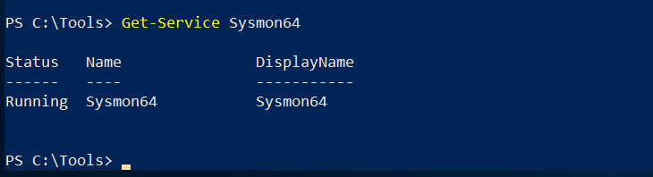

---

### Sysmon Configuration

Sysmon configured with a custom XML ruleset for process, registry, network, and DNS visibility.

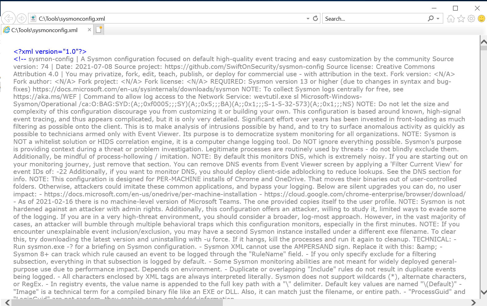

---

### Audit Policy Hardening

Audit policies configured for detailed tracking and security visibility.

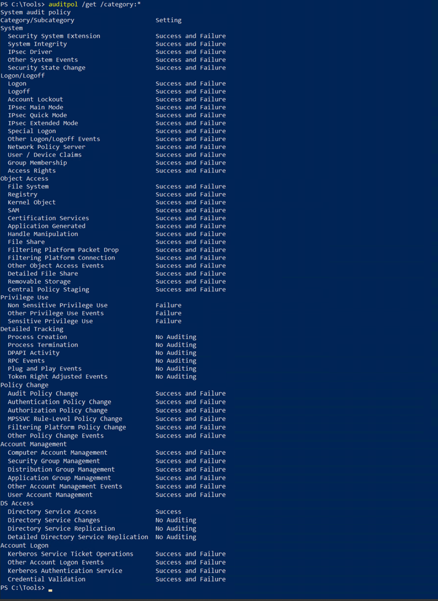

Shows STIG-aligned settings such as:

- Logon/Logoff
- Account Logon
- Object Access
- Policy Change
- System
- Detailed Tracking

---

### Registry Hardening (LSA & Authentication)  
Registry keys under LSA hardened to restrict anonymous access and improve credential security.

**Screenshot:**  
Regedit →  
`HKLM\SYSTEM\CurrentControlSet\Control\Lsa`

Common hardened values include:

- LmCompatibilityLevel  
- NoLMHash  
- RestrictAnonymous  
- RestrictAnonymousSAM  
- Security Packages  

*(RunAsPPL is optional and not required for this project.)*

---

### Firewall Hardening

Firewall profiles enforced and logging enabled.

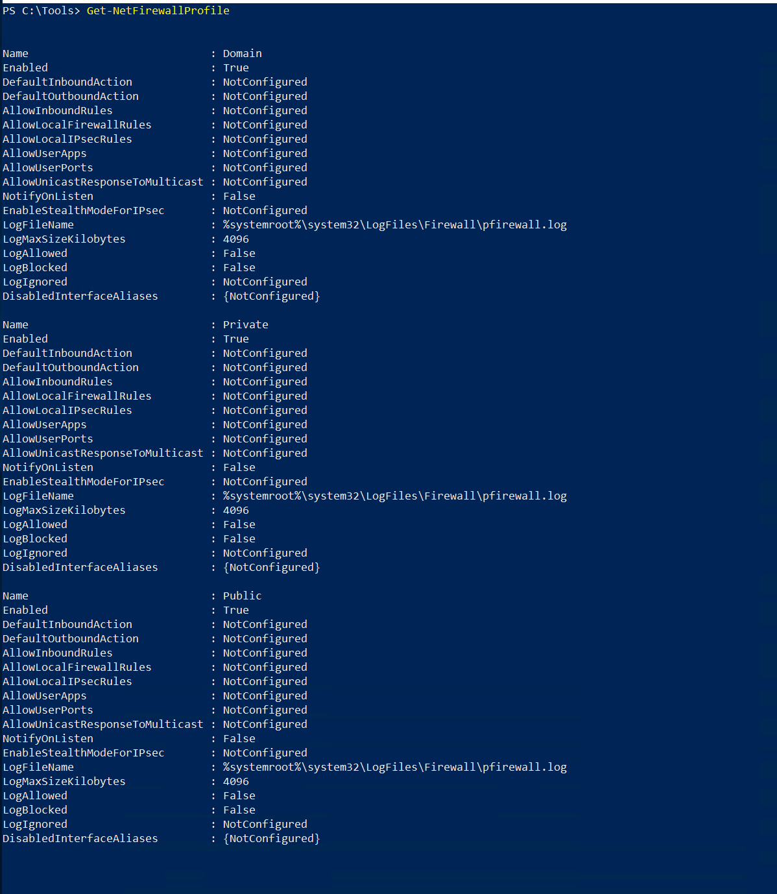

Shows:

- Domain: Enabled  
- Private: Enabled  
- Public: Enabled  
- DefaultInbound: Block
- ---

### Registry Hardening (LSA & Authentication)

Registry keys under LSA hardened to restrict anonymous access and improve credential security.

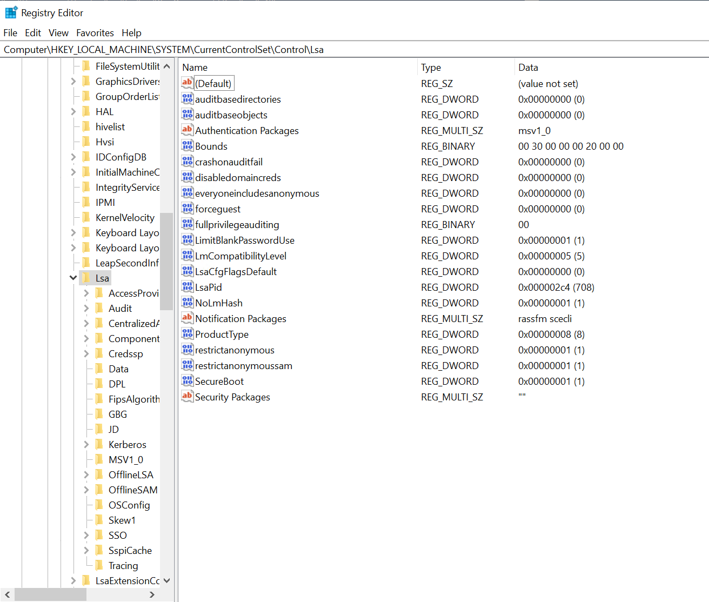

---

## 4. Telemetry Pipeline (AMA + DCR)

### Azure Monitor Agent Installed

AMA installed to collect Sysmon and Windows event logs.


### Data Collection Rule (DCR)

DCR configured to collect Application, System, Security, and Sysmon logs.

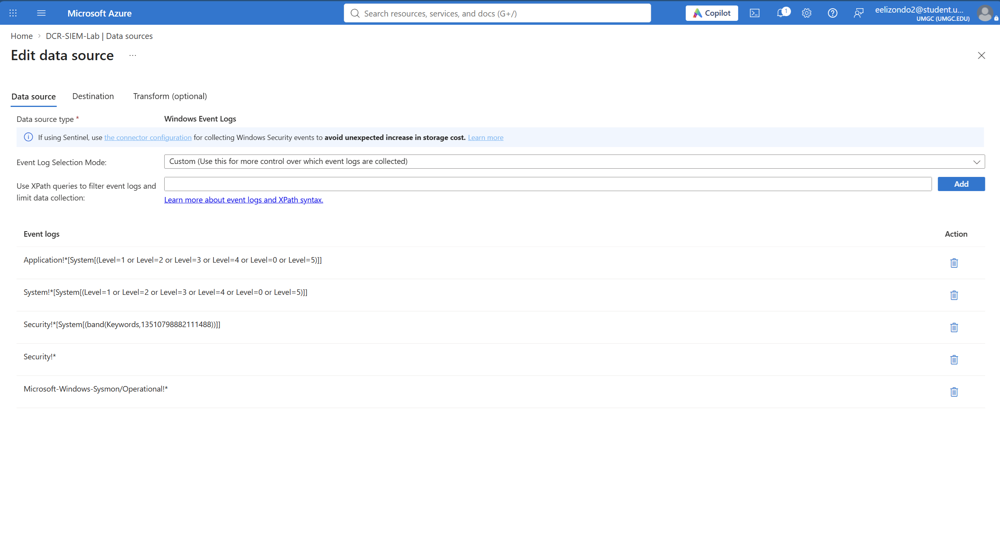

---

## 5. Microsoft Sentinel Enablement

Sentinel enabled on the Log Analytics Workspace.

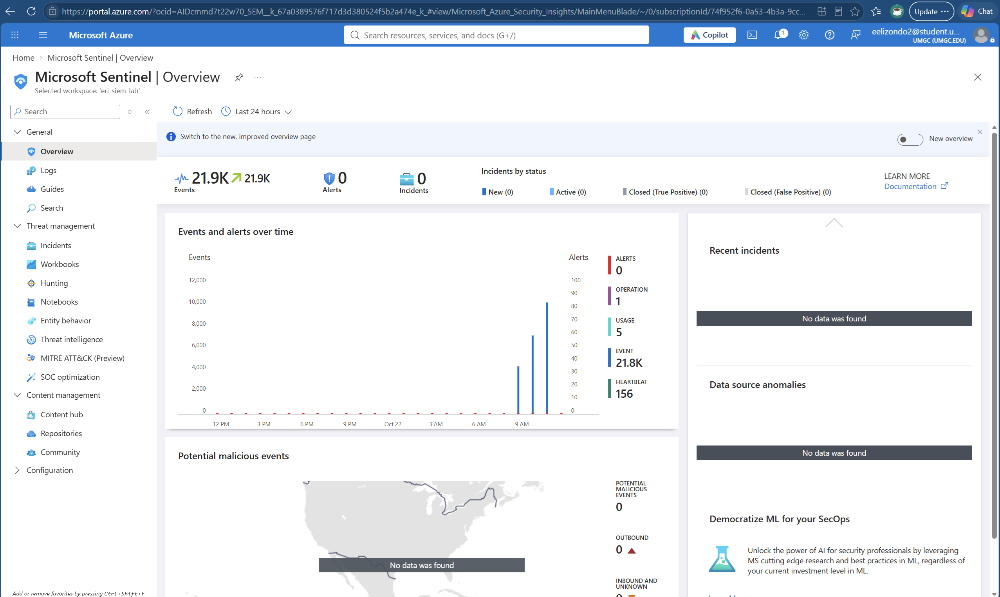

---

## 6. KQL Validation Queries

These queries validate that telemetry is flowing correctly into Microsoft Sentinel.

### Sysmon Logs

```kql
Event
| where EventLog == "Microsoft-Windows-Sysmon/Operational"
| order by TimeGenerated desc
| take 20
```

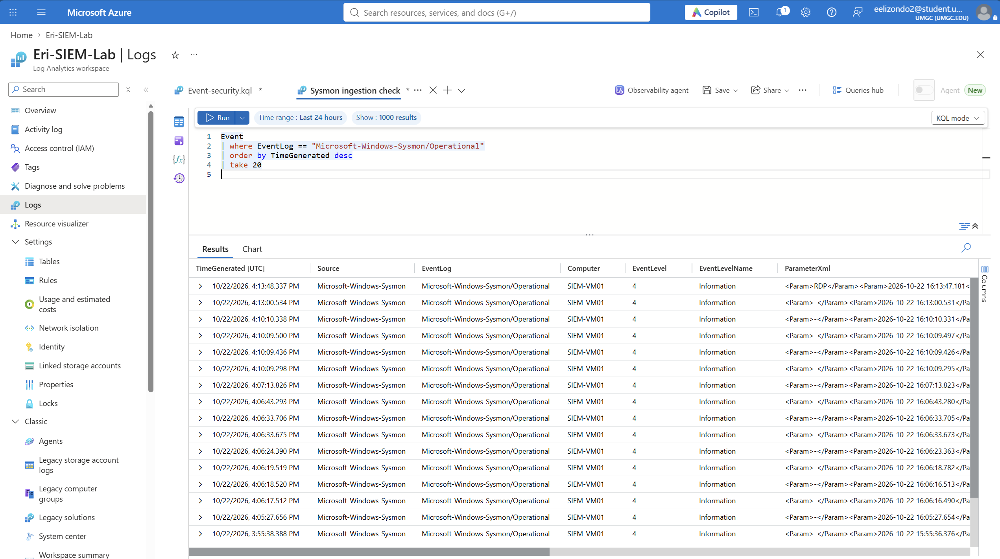

---

### Sysmon Activity Review

```kql
Event
| where EventLog == "Microsoft-Windows-Sysmon/Operational"
```

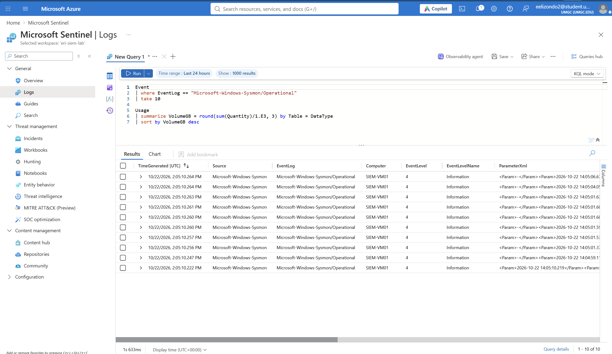

---

### Security Event Logs

```kql
SecurityEvent
| take 20
```

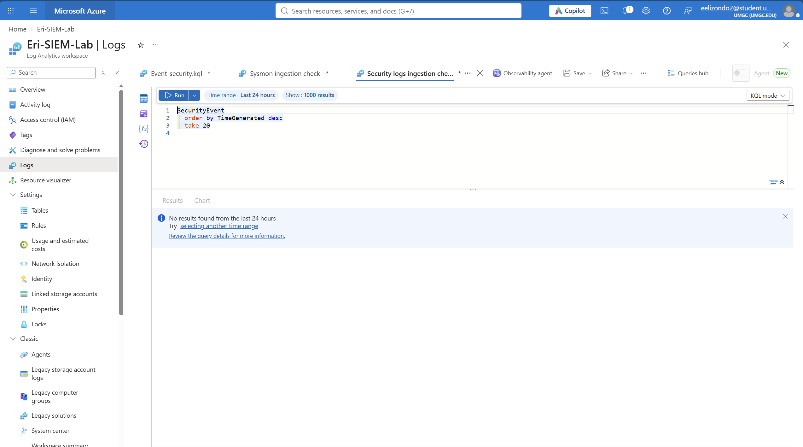

---

### Event Log Summary

```kql
Event
| summarize count() by EventLog
```

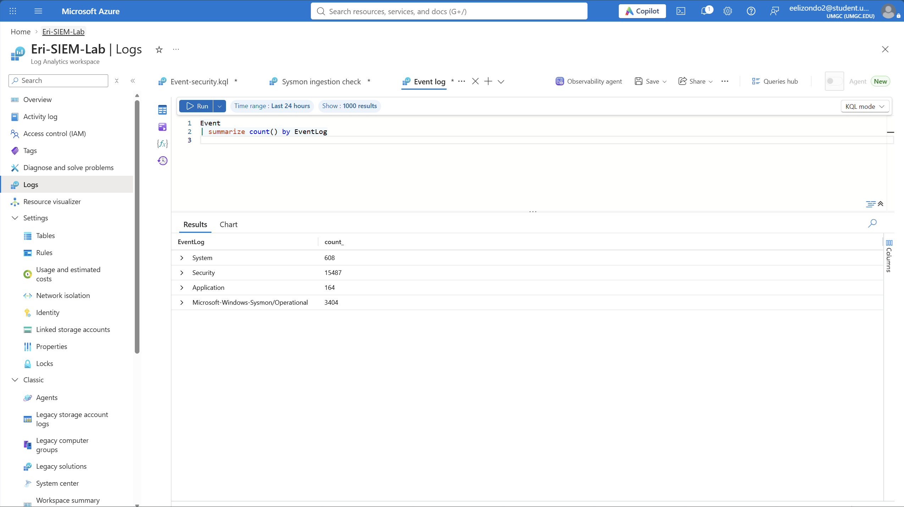

---

### AMA Heartbeat

```kql
Heartbeat
| take 10
```

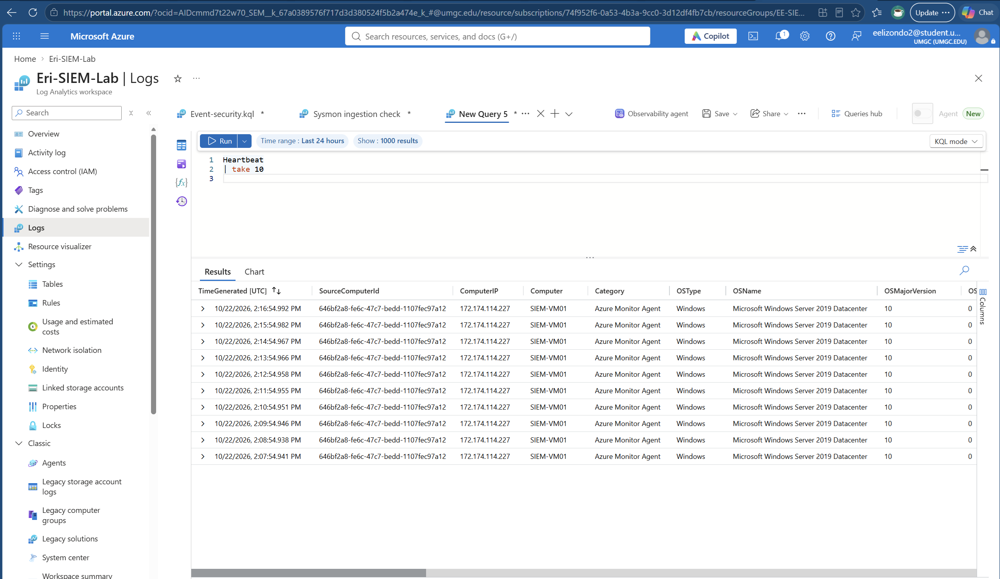


---

## 7. Results
This section shows the successful ingestion of:

- Sysmon telemetry 
- Windows Security logs 
- AMA heartbeat
- Event log channels  

---

## 8. Lessons Learned
- Sysmon logs may appear in the Event table until normalization content packs are installed.
- The Sysmon table does not automatically exist — this is normal.
- Azure for Students uses “Create” instead of “Add” when enabling Sentinel.
- Hardening steps remain visible and screenshot-able even if screenshots weren’t captured initially.
- AMA + DCR provide a clean, DoD-style ingestion pipeline.

---

## 9. Future Enhancements
### Optional expansions:

- Add a Linux VM + Sysmon for Linux
- Add Syslog ingestion from network devices
- Add Sentinel Analytics rules
- Add custom hunting queries
- Add workbook dashboards

---
